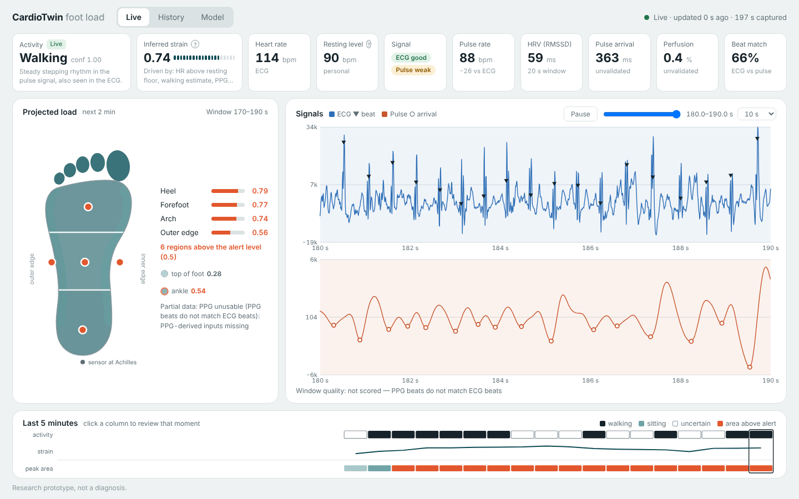

# NeuroSox

A sock-mounted ECG + PPG prototype. A TI AFE4950 EVM records the signals and a TI SK-AM62B board computes everything on the board itself, using the Python standard library only. A laptop shows the results in a browser.

Every 10 seconds the board analyses the last 20 seconds of signal and reports four things:
- heart rate, heart-rate variability, pulse arrival time and perfusion, plus a signal-quality check;
- **activity**: `sitting` (sitting or standing still), `walking` or `uncertain`;
- **inferred strain**: a 0–1 model index of physiological load;
- **projected load** on 7 foot regions over the next 2 minutes.

> **Research prototype, not a diagnostic device.** Activity, strain and region load are model outputs from one sensor site. They are not measured pressure, muscle tension or pain.



---

## 1. Try it without hardware (about 5 minutes)

You need Linux or macOS with Python 3.8 or newer. There is nothing to install.

```bash
git clone <this repo> && cd NueroSox

# Terminal 1: replay the walking recording at 4x speed, the way the board would process it live
python3 board/cardiotwin_board.py --replay data/walk3.jsonl --realtime --speed 4 \
        --reset --rest-hr 90 --state /tmp/ct_state.json --log /tmp/ct_windows.jsonl > /tmp/ct.log

# Terminal 2: start the dashboard on that output
python3 laptop/host_dashboard.py --file /tmp/ct.log
```

Open **http://127.0.0.1:8000**. The first result appears about 5 seconds in (20 s of signal at 4x). The run takes about 1 minute.

- Replace `walk3` with `sit_clean` to see the sitting recording. Keep `--rest-hr 90` for both, because that subject rests at about 90 bpm.
- Drop `--realtime --speed 4` to process a file instantly. The dashboard then shows the whole run, and after 15 s it reports "No data", because nothing new is arriving.
- The **History** tab shows the per-region heatmap. The **Model** tab shows the region weights and how to read the page.

## 2. Run the checks

```bash
git show 340a124:board/cardiotwin_board.py > /tmp/orig_board.py   # the board code before this update

python3 -I -m unittest discover -s tests -p "test_*.py"     # 62 tests; dashboard tests are skipped without google-chrome
python3 -I tests/replay_check.py --orig /tmp/orig_board.py --data data

python3 -I tools/tune_eval.py
```

- **Unit tests:** cover the model, a synthetic sit/walk/sit replay, and the dashboard in headless Chrome.
- **Regression check:** commit `340a124` is the board code before the activity, strain and area model was added. The check replays the original recordings through that version and the current one and shows the original fields are identical. It also writes `tests/out/observations.md`.
- **Tuning comparison:** compares the default settings with the tuned `board/twin_config.json` on every recording.

The synthetic tests show the code does what it was designed to do. They are not evidence of accuracy.

## 3. Run it on the hardware

The full step-by-step guides are [`docs/SETUP_GUIDE.md`](docs/SETUP_GUIDE.md) (sensor placement and wiring) and [`docs/DEMO_RUNBOOK.md`](docs/DEMO_RUNBOOK.md) (a live session). In short:

1. **Install on the board.** Copy everything in `board/` to `/root/afe_data/` on the board's SD card (second partition).
2. **Connect the board's serial console to the laptop with a log file. [LAPTOP, terminal A]**
   ```bash
   picocom -b 115200 -g pico.log /dev/ttyUSB0
   ```
   Log in as `root`.
3. **Start the board. [BOARD, inside terminal A]**
   ```bash
   cd /root/afe_data
   python3 cardiotwin_board.py --live --profile AFE4950_Tagged.cfg --reset --rest-hr 90 --raw-out session.jsonl
   ```
   - `--profile` is required. Without it the EVM is not configured and no data arrives.
   - Set `--rest-hr` to the subject's resting heart rate, or use `--calibrate-rest 60` to learn it from the first minute while the subject sits still.
   - `--raw-out` saves the raw packets, which you can replay later with `--replay`.
4. **Start the dashboard. [LAPTOP, terminal B]**
   ```bash
   python3 laptop/host_dashboard.py --file pico.log
   ```
   Then open http://127.0.0.1:8000.
5. **Stop.** In terminal A, press Ctrl-C to stop the board, then Ctrl-A Ctrl-X to leave picocom. In terminal B, press Ctrl-C.

## 4. Where things are

| Path | What it is |
|---|---|
| `board/` | Runs on the SK-AM62B. `cardiotwin_board.py` is the pipeline, `activity_model.py` is the activity, strain and load model, and `twin_config.json` holds its settings. |
| `laptop/` | The dashboard (`host_dashboard.py` + `dash_template.html`). |
| `data/` | Raw recordings. `sit_clean` and `walk3` are labelled sitting and walking (replay with `--rest-hr 90`). |
| `tests/`, `tools/` | Tests and the config comparison tool. |
| `docs/` | Setup guide, demo runbook, project context, tuning notes. |
